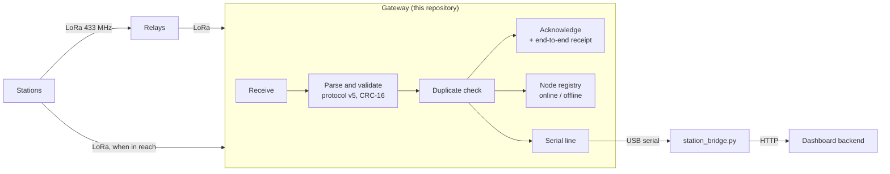

<div align="center">

# TerraWatch gateway firmware

**The root of the station network.** It listens for every station and relay, checks each packet, acknowledges it, and prints it on the serial port for the bridge to the dashboard.

[Architecture](docs/architecture.md) &nbsp;·&nbsp; [Station firmware](https://github.com/Terra-Watch/node-firmware) &nbsp;·&nbsp; [Relay firmware](https://github.com/Terra-Watch/relay-firmware) &nbsp;·&nbsp; [Bridge setup](https://github.com/Terra-Watch/dashboard/blob/main/docs/STATIONS_BRIDGE_SETUP.md) &nbsp;·&nbsp; [Hardware test guide](https://github.com/Terra-Watch/relay-firmware/blob/main/TESTING.md)


</div>



---

The gateway has **no Wi-Fi, no HTTP and no backend client**, on purpose. It is a radio and a serial port. Readings reach the TerraWatch backend through the bridge script in the dashboard repository (`backend/scripts/station_bridge.py`), which runs on the computer the gateway is plugged into.

## What it does

| | |
|---|---|
| **Receive** | Continuous LoRa receive at 433 MHz; parses and validates protocol v5 packets, the same wire format as the station firmware |
| **Acknowledge** | Heartbeat and data acknowledgements, with duplicate detection |
| **Root of the tree** | Sends an end-to-end receipt for data that came through relays, back through the relay it arrived through. It remembers recent data longer, so a resent alert is not counted twice |
| **Registry** | A node table with liveness: online or offline per node (`src/Registry`) |
| **Route adverts** | Relay-to-relay route advertisements (type 5) are ignored without an error |
| **Diagnostics** | An optional RF diagnostic build (`diagnostic-gateway`) |

## What comes out of the serial port

```
[HEARTBEAT RX] ...
[DATA RX] source=0x.. sequence=.. rssi=.. snr=.. payload=<hex>
```

The payload is whatever the station sent, and decoding is left to the bridge:

| First byte | Meaning |
|---|---|
| `S` | Air quality and weather: temperature, humidity, PM2.5, PM10 |
| `P` | The station's fixed position |
| `A` | A sound alert: kind and confidence |

## Build and test

```bash
pio run                              # default env esp32-s3-devkitm-1
pio run -e diagnostic-gateway        # with RF diagnostics
pio run -t upload --upload-port <your port>
pio device monitor -b 115200
bash test/run_protocol_contract.sh   # host test: gateway and station agree on the wire format
```

The contract test needs [node-firmware](https://github.com/Terra-Watch/node-firmware) cloned next to this repository.

## Wiring (ESP32-S3)

The SX1278 uses the same pins as the station: SCK 12, MISO 13, MOSI 11, CS 10, RST 9, DIO0 14. 3.3 V only; fit the 433 MHz antenna before transmitting.

## Layout

| Path | Content |
|---|---|
| `src/` | App, gateway service, ack handler, registry |
| `lib/` | LoRa driver, protocol parser and validator, logger, HAL interfaces |
| `include/BuildConfig.h` | Name and version |
| `docs/architecture.md` | The object graph and the per-loop flow |
| `test/` | The protocol contract test |

## Status

Builds. **Not tested on hardware.** To try it with a station and a relay, follow the [hardware test guide](https://github.com/Terra-Watch/relay-firmware/blob/main/TESTING.md) and send back what you see.

---

<sub>Part of <a href="https://github.com/Terra-Watch">TerraWatch</a>: <a href="https://github.com/Terra-Watch/node-firmware">station</a> · <a href="https://github.com/Terra-Watch/relay-firmware">relay</a> · <a href="https://github.com/Terra-Watch/acoustic-ml">sound classifier</a> · <a href="https://github.com/Terra-Watch/dashboard">dashboard</a></sub>
